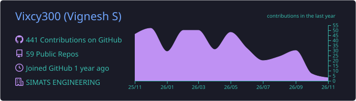
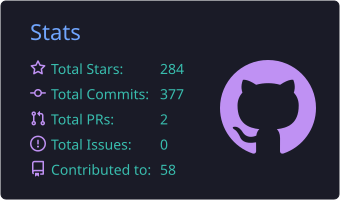
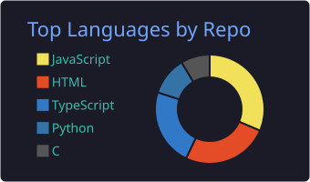
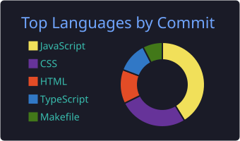

<div align="center">

<!-- Thin accent line -->


<br/>

<!-- Name: Space Grotesk, types once and stays -->


<!-- Role line: small, quiet, rotating -->


<br/><br/>

<!-- Links: each <a></a> is on ONE line so no underline artifacts appear -->
<p>
<a href="https://vigneshh.me"></a>
<a href="mailto:vigneshigt@gmail.com"></a>
<a href="https://www.linkedin.com/in/vigneshs20/"></a>
<a href="https://github.com/Vixcy300"></a>
<a href="https://x.com/teamig14"></a>
<a href="https://www.instagram.com/axstonm?igsh=MXJ4YnZid3hzcDdtbw=="></a>
</p>

<!-- Counters -->
<p>


</p>

<!-- Thin accent line (bottom) -->


</div>

---

## 👨‍💻 About Me

```typescript
const vignesh = {
  pronouns: "he/him",
  location: "Chennai, Tamil Nadu, India 🇮🇳",
  education: "B.Tech @ SIMATS Engineering College",
  languages: ["English", "Tamil"],
  currentFocus: [
    "MERN Stack Development",
    "Next.js 16+ & React 19",
    "Cloud Deployment on Azure",
  ],
  philosophy: "60fps animations & pixel-perfect design",
  funFact: "I build production apps on a ₹0 budget 💸",
};
```

- 🔭 Currently building an **ultra-modern developer portfolio**
- 🌱 Deep diving into **Next.js 16, React 19, and Azure Cloud**
- 👯 Looking to collaborate on **open source and hackathons**
- 💬 Ask me about **Next.js, React, Node.js, MongoDB**
- ⚡ Fun fact: **I turn coffee into code at 3 AM** ☕

---

## 🛠️ Tech Arsenal

<div align="center">

**Frontend**


**Backend & Database**


**Tools & Cloud**


</div>

---

## 🚀 Featured Projects

| Project | Description | Tech Stack |
|:--|:--|:--|
| 🎨 **Developer Portfolio** | Ultra-modern portfolio with 3D elements and scroll animations | `Next.js` `GSAP` `Three.js` `Tailwind` |
| 💰 **AI Finance App** | Cross-platform finance tracker with an AI assistant | `Flutter` `Gemini AI` `Firebase` |
| ♻️ **[EcoSort AI](https://github.com/Vixcy300/MatriXort-AI-Deep-Learning)** | Computer-vision waste classification system | `Python` `ResNet-50` `TensorFlow` |
| 🔐 **E2E Encrypted Chat** | Secure messaging with file transfer | `Next.js` `WebSocket` `AES-GCM` |
| 🎓 **Student Portal** | Role-based academic management system | `Next.js` `Express` `MongoDB` |
| 🏥 **Healthcare Portal** | Patient-doctor management platform | `Full-stack` `PostgreSQL` |
| 🗺️ **Recycling Map** | Crowdsourced recycling locations | `React` `Firebase` `Mapbox` |
| 📊 **BMI Analyzer** | Lifestyle analysis with an AI chatbot | `Flask` `Pandas` `Gemini AI` |
| 🏁 **[Protothon 2025](https://github.com/Vixcy300/protothon-hackathon2025)** | Hackathon project | See repo |

---

## 📊 GitHub Analytics

<div align="center">







<br/><br/>

<!-- Streak card, restyled to match the indigo palette -->


</div>

---

## 🎯 Current Focus

| | |
|:--|:--|
| 📚 **Learning** | Next.js 16 · React 19 · Azure Cloud |
| 🔨 **Building** | Ultra-modern portfolio with smooth 60fps animations |
| 🧭 **Exploring** | MERN architecture · scalable deployments |
| 🤝 **Open to** | Collaborations · hackathons · freelance work |

---

## 📫 Let's Connect

<div align="center">

<p>
  <a href="mailto:vigneshigt@gmail.com"></a>
  <a href="https://www.linkedin.com/in/vigneshs20/"></a>
  <a href="https://vigneshh.me"></a>
</p>

<sub>Open to internships, hackathon teams, and open-source collaboration.</sub>

<br/><br/>

<!-- Contribution snake (generated by the existing snake workflow) -->
<picture>
  <source media="(prefers-color-scheme: dark)" srcset="https://raw.githubusercontent.com/Vixcy300/Vixcy300/output/github-snake-dark.svg" />
  <source media="(prefers-color-scheme: light)" srcset="https://raw.githubusercontent.com/Vixcy300/Vixcy300/output/github-snake.svg" />
  
</picture>

</div>

<!-- Footer wave matching the header -->
